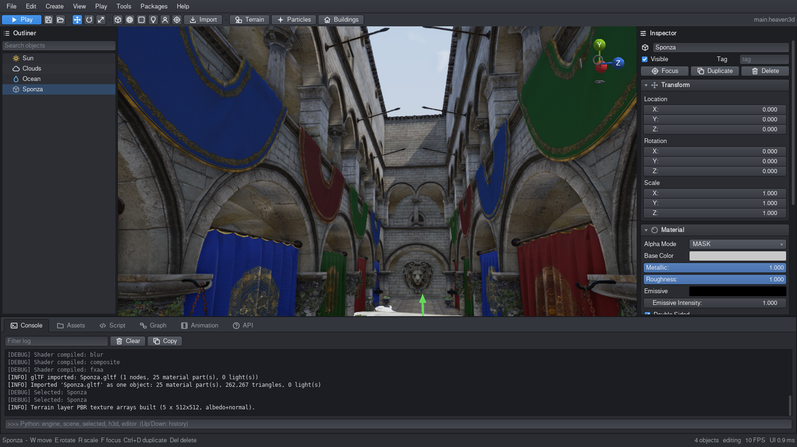

<div align="center">


# Heaven3D

**A complete 3D game engine built from the metal up — in Python.**

Deferred PBR rendering · CPU physics · Built-in editor · Standalone runtime



</div>

Heaven3D is a from-scratch 3D game engine written in Python on top of [ModernGL](https://github.com/moderngl/moderngl). No Panda3D, Unity, Unreal or GameGuru under the hood: the renderer, physics, editor, importers, audio and gameplay systems are all written for Heaven3D.

## Install

```bash
pip install heaven3d
```

Then:

| Command | What it starts |
|---|---|
| `heaven3d-hub` | the Hub: projects, templates, packages, tutorials |
| `heaven3d` | the editor (`heaven3d --project game.heaven3d`) |
| `heaven3d-runtime --project game.heaven3d` | play a project without the editor |

Or use the engine as a module:

```python
import heaven3d
engine = heaven3d.HeavenEngine(mode="runtime", project_path="game.heaven3d")
engine.run()
```

**Requirements:** Python 3.10+ and a GPU with **OpenGL 3.3 Core** or newer. The Hub uses tkinter, which comes with Python on Windows and macOS; on Linux install it with `sudo apt install python3-tk` (or your distro's equivalent). For Draco-compressed glTF models: `pip install "heaven3d[draco]"`.

## Asset packs

To fit PyPI's size limits, the big asset packs are downloaded separately from the [Releases page](https://github.com/lolgg313/Heaven3D/releases) as `.h3dpkg` files:

| Pack | What's inside |
|---|---|
| `hqfps_weapons` | twenty first-person weapons with their own animations and sounds (HQ FPS Arena template) |
| `mh_characters` | animated MakeHuman townsfolk and zombies |
| `tropical_islands` | procedural tropical islands: beaches, palms, jungle |
| `farscream` | an open-island shooter map generator (needs the three packs above) |

Install one in the Hub (**Packages > Install**) or from a terminal:

```bash
heaven3d-hub --install-package hqfps_weapons-0.4.1.h3dpkg
```

The small code packages (Car Race Kit, Spline Roads, Physics Plus, Light Theme) are already included.

## Features

- **Rendering:** deferred PBR (Cook-Torrance GGX), HDR + ACES tone mapping, SSAO, screen-space reflections, bloom, PCF soft shadows, FXAA + 4× MSAA, procedural sky and clouds, a Gerstner-wave ocean, instancing
- **Physics (pure CPU):** box, sphere, capsule, plane, heightfield and triangle-mesh colliders, sequential-impulse solver, sleeping islands, raycasts, triggers, a character controller; Numba-compiled hot paths, bit-identical to the Python path
- **Editor:** inspector, gizmos, view modes (Lit / Lit + Wire / Wire), terrain tools, the Building Maker (rooms, houses, whole towns), code and visual scripts, animation, hot reload
- **Gameplay:** a blueprint system with ready-made FPS controller, weapons, enemies, pickups, spawners and triggers; 3D audio; HUD
- **Import:** full glTF 2.0 / GLB, Blender `.blend` files read directly (2.5x to 5.0), OBJ + MTL, FBX, DirectX `.x`
- **Export:** your game as a standalone Windows `.exe`, Linux or macOS app, with your own icon (needs a standalone edition)

## Links

- Source, documentation and changelog: <https://github.com/lolgg313/Heaven3D>
- Standalone editions (no Python needed) and asset packs: <https://github.com/lolgg313/Heaven3D/releases>

Apache License 2.0
