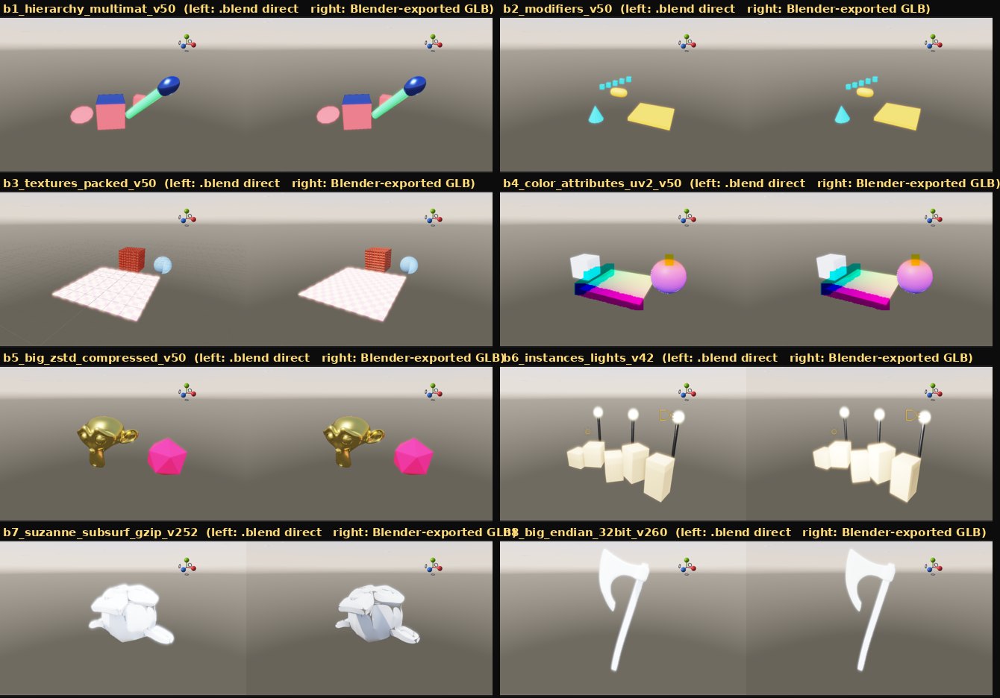
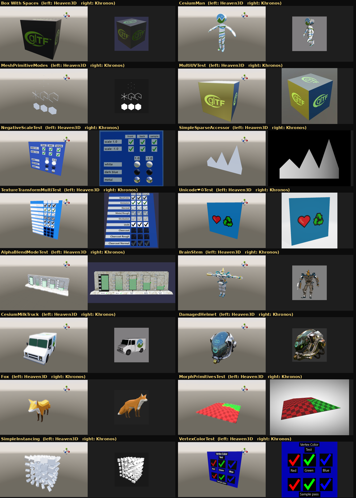
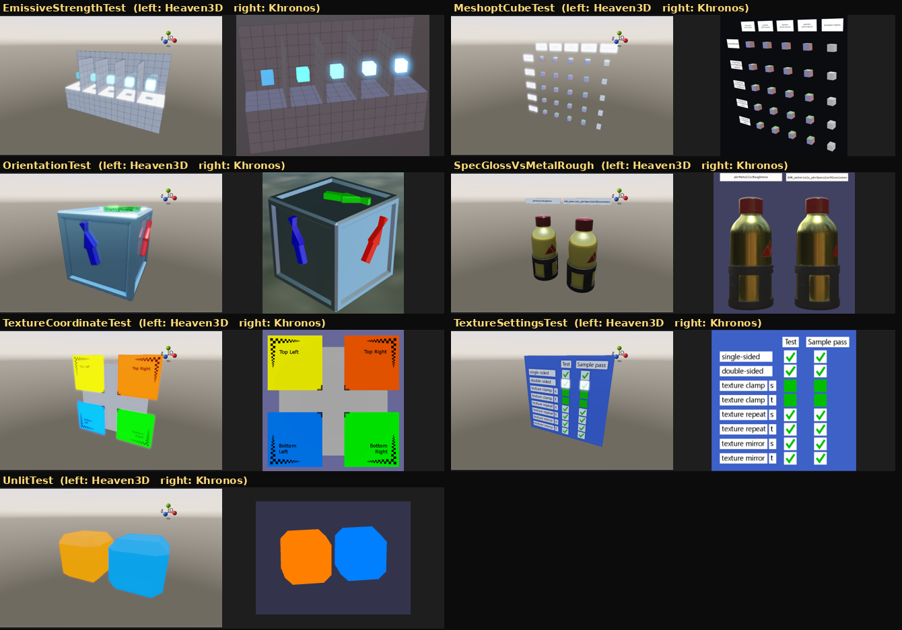

# Importer tests (.blend / .gltf / .glb)

Heaven3D 2.7.0 replaces the old importers with new ones written for the engine:

* **`.blend`** — reads the Blender file format directly (no Blender install needed),
  from Blender 2.5x up to **Blender 5.0**, including gzip / zstd compressed files,
  32-bit and big-endian files, and the modifiers Mirror, Array, Subdivision Surface,
  Solidify, Weld, Edge Split, Triangulate, Smooth by Angle and Multires (subdivision levels; sculpted detail is not stored in a readable form).
* **`.gltf` / `.glb`** — the full glTF 2.0 spec: every accessor form (sparse, strided,
  normalized), all 7 primitive modes, skins (bind pose), morph targets, GPU instancing,
  `KHR_meshopt_compression`, `KHR_draco_mesh_compression` (needs `DracoPy`),
  texture transform, unlit, emissive strength, spec-gloss, transmission, lights,
  texture wrap modes and a second UV set.

There are **8 hard test files for each format** (`.blend`, `.gltf`, `.glb`) plus 7
extra glTF extension tests — 31 files in total.

## Run the tests

```bash
python tests/importers/run_importer_tests.py            # no window or GPU needed
python tests/importers/run_importer_tests.py --render   # also writes screenshots to tests/importers/output/
python tests/test_one_object.py                         # "one object" editor checks (needs a GPU)
```

Current result: **31 / 31 importer files pass** and **18 / 18 one-object checks pass**.

## How each file was verified

The expected numbers in `expected.json` were not just copied from our own output:
each file was compared with an independent reference.

| set | file | triangles | parts | lights | verified against |
| --- | --- | ---: | ---: | ---: | --- |
| blend | `b1_hierarchy_multimat_v50.blend` | 622 | 3 | 0 | Blender 5.0.1 evaluated scene (bpy): identical triangle count, world bounding box within 0.001; per-vertex positions/normals identical to Blender's own glTF export (parent inverse, quaternion/axis-angle/ZXY rotations, negative scale, n-gons, 3 material slots) |
| blend | `b2_modifiers_v50.blend` | 532 | 2 | 0 | Blender 5.0.1 evaluated scene (bpy): identical triangle count, world bounding box within 0.001; Mirror(+merge)+Subdivision(limit surface), Array, Solidify, Mirror-Y+Triangulate match Blender vertex-for-vertex (max error 0.0000) |
| blend | `b3_textures_packed_v50.blend` | 974 | 3 | 0 | Blender 5.0.1 evaluated scene (bpy): identical triangle count, world bounding box within 0.001; packed albedo+alpha clip, packed normal map, external relative texture with a space in its name, emission, blended glass; UVs identical |
| blend | `b4_color_attributes_uv2_v50.blend` | 460 | 3 | 0 | Blender 5.0.1 evaluated scene (bpy): identical triangle count, world bounding box within 0.001; byte corner colours + float point colours + 2 UV maps identical to Blender export; render matches |
| blend | `b5_big_zstd_compressed_v50.blend` | 62,996 | 2 | 0 | Blender 5.0.1 evaluated scene (bpy): identical triangle count, world bounding box within 0.001; zstd-compressed file, 63k triangles, sharp-edge split normals identical (40,115 vertices like Blender) |
| blend | `b6_instances_lights_v42.blend` | 864 | 3 | 3 | Blender 4.2 file checked in Blender 5.0.1: linked duplicates, 3 collection instances, point/spot/sun lights; identical triangles, bbox and per-vertex data |
| blend | `b7_suzanne_subsurf_gzip_v252.blend` | 251,904 | 1 | 1 | Blender 2.52 gzip file checked in Blender 5.0.1: subdivision level 4 = 251,904 triangles exactly, bbox exact, positions within 0.009 (0.3%), normals median error 0.00 deg |
| blend | `b8_big_endian_32bit_v260.blend` | 115,712 | 2 | 1 | Blender 2.60 BIG-ENDIAN 32-bit file (Blender 5 itself refuses it) checked in Blender 4.2.23: 115,712 triangles exactly, bbox within 0.0006, normals 100% |
| gltf | `Box With Spaces.gltf` | 12 | 1 | 0 | Blender glTF importer + Khronos screenshot: percent-encoded URIs with spaces |
| gltf | `CesiumMan.gltf` | 4,672 | 1 | 0 | skinned: default pose = bind pose verified (skinned positions == mesh-node world * raw, error 0); Blender shows animation frame 1 instead |
| gltf | `MeshPrimitiveModes.gltf` | 224 | 1 | 0 | all 7 primitive modes; 16 triangle-mode triangles as in Blender + POINTS/LINES/LINE_LOOP/LINE_STRIP rendered as thin geometry; matches Khronos screenshot |
| gltf | `MultiUVTest.gltf` | 12 | 1 | 0 | Blender glTF importer + Khronos screenshot: TEXCOORD_1 drives the second texture |
| gltf | `NegativeScaleTest.gltf` | 7,724 | 6 | 0 | Blender glTF importer + Khronos screenshot: every check green (mirrored nodes, winding, back-face culling) |
| gltf | `SimpleSparseAccessor.gltf` | 12 | 1 | 0 | Blender glTF importer + Khronos screenshot: sparse accessor |
| gltf | `TextureTransformMultiTest.gltf` | 3,956 | 29 | 0 | Blender glTF importer + Khronos screenshot: KHR_texture_transform on every slot, texCoord override |
| gltf | `Unicode❤♻Test.gltf` | 2 | 1 | 0 | Blender glTF importer + Khronos screenshot: unicode file names |
| glb | `AlphaBlendModeTest.glb` | 61 | 6 | 0 | Blender glTF importer + Khronos screenshot: OPAQUE / MASK (cutoffs) / BLEND |
| glb | `BrainStem.glb` | 61,666 | 59 | 0 | skinned (many skins): bind-pose check exact; identical result to the Draco and meshopt variants |
| glb | `CesiumMilkTruck.glb` | 3,624 | 4 | 0 | Blender glTF importer (bbox 0.0015) + Khronos screenshot: hierarchy, shared meshes; editor lock test (18/18) |
| glb | `DamagedHelmet.glb` | 15,452 | 1 | 0 | Blender glTF importer + Khronos screenshot: embedded PBR maps (albedo, MR, normal, emissive, AO) |
| glb | `Fox.glb` | 576 | 1 | 0 | skinned: bind-pose check (error 1e-5); Blender shows animation frame 1 instead |
| glb | `MorphPrimitivesTest.glb` | 32 | 2 | 0 | Blender glTF importer: morph target default weights |
| glb | `SimpleInstancing.glb` | 1,500 | 1 | 0 | Blender glTF importer: EXT_mesh_gpu_instancing, 125 instances = 1500 triangles |
| glb | `VertexColorTest.glb` | 36 | 2 | 0 | Blender glTF importer + Khronos screenshot: every vertex-colour check passes |
| extra | `EmissiveStrengthTest.glb` | 90 | 6 | 0 | Blender glTF importer + Khronos screenshot: KHR_materials_emissive_strength |
| extra | `MeshoptCubeTest.gltf` | 320 | 11 | 0 | KHR_meshopt_compression v0+v1 codecs and all filters: all 60 buffer views byte-identical to the meshoptimizer C library |
| extra | `OrientationTest.glb` | 524 | 7 | 0 | Blender glTF importer: node rotations |
| extra | `SpecGlossVsMetalRough.glb` | 9,028 | 4 | 0 | Blender glTF importer + Khronos screenshot: KHR_materials_pbrSpecularGlossiness converted per texel; both bottles identical |
| extra | `TextureCoordinateTest.glb` | 10 | 5 | 0 | Blender glTF importer + Khronos screenshot: UV orientation |
| extra | `TextureSettingsTest.glb` | 72 | 10 | 0 | Blender glTF importer + Khronos screenshot: wrap modes repeat/clamp/mirror + single/double sided, all checks pass |
| extra | `UnlitTest.glb` | 88 | 2 | 0 | Blender glTF importer + Khronos screenshot: KHR_materials_unlit |

*parts* = material groups; every part is a locked piece of **one** imported object.

## One imported model = one object

Children and material parts of an imported model are part of the main object:

* the Hierarchy shows one row per model;
* clicking any part in the viewport selects the whole model;
* move / rotate / scale, duplicate and delete always act on the whole model;
* Box / Sphere / Capsule colliders fit the whole model, and a Mesh collider uses the
  triangles of every part;
* the project file stores the model once, and reloading rebuilds it the same way.

`tests/test_one_object.py` checks all of this in the real editor.

## Screenshots

Left: Heaven3D. Right: the reference.

**8 `.blend` files** (reference: the same scene exported to GLB by Blender 5.0.1 / 4.2)



**8 `.gltf` + 8 `.glb` files** (reference: Khronos sample screenshots)



**Extra extension tests**



Skinned models (CesiumMan, BrainStem, Fox) are shown in their bind pose; animations are
not played yet. Lines and points (MeshPrimitiveModes) are drawn as thin geometry.

## Test files and licences

* `assets/blend/` — b1–b6 were generated with Blender 5.0.1 / 4.2 by
  `tools/gen_blend.py`; b7 and b8 are old-format files from the assimp test set
  (see `assets/licenses/assimp-blend-files.md`).
* `assets/gltf/`, `assets/glb/`, `assets/extra/` — Khronos glTF Sample Assets; every
  model's licence is in `assets/licenses/`.
* `tools/truth_gltf.py` — the script that collected Blender's glTF-importer numbers.
